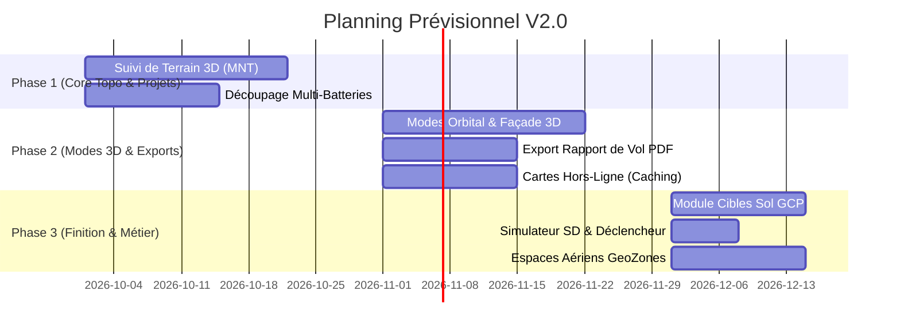

# 📋 Cahier des Charges - Améliorations Futures & Roadmap
**Projet :** DJI Mapper (Dr_Mapper)  
**Version cible :** V2.0+  
**Date de rédaction :** 21 Septembre 2026  
**Statut :** Planifié pour implémentation future  

---

## 1. 🎯 Contexte et Objectifs

L'application **DJI Mapper** dispose d'une base solide pour la planification de missions photogrammétriques et LiDAR :
- Planification en **Polygone (Grille 2D Orthophoto)** avec contrôle GSD, orientation et chevauchements.
- Planification en **Corridor (Linéaire)** pour les routes, cours d'eau et réseaux.
- Planification par **Waypoints directs / Import GPX et KML** multi-modes.
- Contrôle qualité photogrammétrique : **Angle d'ombrage solaire**, météo intégrée (Open-Meteo), validation géométrique.
- Export direct vers **DJI Pilot 2 / DJI Fly (KMZ / WPML)** et **Litchi (CSV)**.

**Objectif du présent document :**  
Fournir les spécifications fonctionnelles et techniques des fonctionnalités majeures pour hisser l'application au rang des standards industriels de référence (*DJI Terra, DroneDeploy, UgCS, Pix4Dcapture*).

---

## 2. 🚀 Spécifications Détaillées des Modules d'Amélioration

---

### ⛰️ Module 1 : Suivi de Terrain 3D (*Terrain Following / AGL Constant*)

#### Description du besoin
En zone vallonnée ou montagneuse, voler à une altitude constante par rapport au point de décollage entraîne :
1. Une variation importante de la résolution au sol (GSD hétérogène).
2. Un risque majeur de collision en cas de relief positif ou une perte de résolution en fond de vallée.

#### Fonctionnalités attendues
- **Sources MNT (Modèle Numérique de Terrain) :**
  - Requêtes dynamiques via API MNT mondiale (ex: *Copernicus DEM GLO-30*, *SRTM 30m*, ou *Open-Elevation*).
  - Possibilité pour l'utilisateur d'importer son propre fichier MNT local au format GeoTIFF / DSM.
- **Calcul de l'altitude adaptative :**
  - Interpolation de l'altitude du sol pour chaque waypoint et point de déclenchement photo.
  - Calcul de l'altitude absolue (MSL/WGS84) nécessaire pour maintenir la hauteur relative au sol (**AGL**) cible constante.
- **Visualisation graphique :**
  - Profil altimétrique 2D interactif en bas d'écran (courbe de terrain vs trajectoire de vol du drone).
- **Export KMZ / WPML :**
  - Définition de `executeHeightMode` sur `relativeToStartPoint` avec altitudes calculées ou `WGS84` selon les drones (Mavic 3 Enterprise / Matrice 300/350).

---

### 🏛️ Module 2 : Modes de Vol 3D & Inspection Avancée

#### Description du besoin
Étendre les capacités au-delà de la cartographie zénithale 2D pour répondre aux besoins des architectes, inspecteurs d'ouvrages et modélisateurs 3D.

#### 1. Mode Orbital / Circulaire (POI 3D)
- Définition d'un point d'intérêt central (bâtiment, monument, pylône) et d'un rayon de vol.
- Vol circulaire ou hélicoïdal à altitude(s) définie(s).
- Orientation automatique de la nacelle (Gimbal Pitch & Yaw) vers le centre de la cible en continu.

#### 2. Mode Façade & Scan Vertical
- Définition d'une ligne de base de façade et des hauteurs min/max.
- Génération de passes horizontales superposées ou verticales face à la paroi (barrages, falaises, façades d'immeubles).
- Inclinaison fixe de la caméra à l'horizontale (0°) ou légèrement plongeante (-10° à -15°).

#### 3. Mode Double Grille Oblique (Smart 3D Mesh)
- Grilles croisées à 90° avec orientation automatique du Gimbal à -45° ou -60°.
- Déclenchement optimisé pour capturer à la fois les toitures et les faces verticales pour la reconstruction de maillages 3D (*RealityCapture, Agisoft Metashape, Meshroom*).

---

### 🔋 Module 3 : Découpage Multi-Batteries Intelligent (*Mission Splitting*)

#### Description du besoin
Pour les chantiers industriels de plusieurs dizaines d'hectares, le temps de vol dépasse l'autonomie d'une seule batterie (généralement 20 à 30 min opérationnelles).

#### Fonctionnalités attendues
- **Paramétrage :** Définition de la durée max de sécurité par batterie (ex: 22 minutes ou 75% de décharge).
- **Calcul automatique des segments :**
  - Détection automatique du nombre de batteries nécessaires.
  - Segmentation des lignes de vol en sous-missions (`Mission_Part1`, `Mission_Part2`, `Mission_Part3`).
- **Logique de reprise (Resume Flight) :**
  - Ajout des points de ralliement et de retour au point de départ (RTH) à chaque transition de batterie.
  - Export en un dossier compressé contenant l'ensemble des fichiers KMZ/CSV ordonnés.

---

### 🎯 Module 4 : Gestion des Cibles au Sol (GCPs & Checkpoints)

#### Description du besoin
Les géomètres posent des cibles mesurées au GPS RTK (Ground Control Points) pour caler et vérifier la précision du modèle photogrammétrique.

#### Fonctionnalités attendues
- **Placement de cibles sur la carte :**
  - Positionnement manuel ou import de coordonnées (CSV / TXT / DXF en Lambert 93, UTM, WGS84).
  - Distinction entre *GCPs* (calage) et *Checkpoints* (points de contrôle qualité).
- **Aide au positionnement :**
  - Algorithme d'optimisation de répartition spatiale des cibles (périphérie + centre).
  - Calcul du nombre estimé de clichés aériens voyant chaque cible.
- **Export :**
  - Export du carnet de terrain topo (`gcp_targets.csv`, format compatible avec Pix4D / Agisoft / DJI Terra).

---

### 📄 Module 5 : Générateur de Rapport de Mission & Dossier de Vol (PDF)

#### Description du besoin
Générer en 1 clic un document officiel et soigné à destination des clients, donneurs d'ordre ou autorités aéronautiques avant ou après la mission.

#### Contenu du rapport PDF
- **En-tête & Métadonnées :** Nom du projet, télépilote, date, matériel utilisé (drone + capteur).
- **Cartographie :** Capture d'écran haute résolution de la zone de vol, polygone, lignes de passage et points de sécurité.
- **Données photogrammétriques :** Surface couverte (ha / m²), GSD moyen (cm/px), hauteur de vol, chevauchements (frontal/latéral), orientation.
- **Logistique de vol :** Nombre de photos prévues, durée de vol totale, nombre de batteries requises, espace carte SD estimé (Go).
- **Météo & Solaire :** Vitesse/rafales de vent, couverture nuageuse, indice Kp, angle d'ombrage solaire au moment prévu du vol.
- **Checklist de sécurité pré-vol :** Liste de vérifications conforme aux exigences réglementaires.

---

### 🗺️ Module 6 : Cartographie Hors-Ligne (*Offline Map Tile Caching*)

#### Description du besoin
Sur le terrain, les missions se déroulent fréquemment en zone rurale ou isolée sans couverture réseau 4G/5G.

#### Fonctionnalités attendues
- **Outil de sélection de zone :** Boîte englobante ou rayon autour du chantier.
- **Téléchargement multi-niveaux de zoom :** Mise en cache des tuiles OpenStreetMap, Esri Satellite ou OpenTopoMap (niveaux de zoom 12 à 18).
- **Gestionnaire de stockage :** Vue des zones téléchargées, taille occupée sur disque (Mo/Go), possibilité de suppression.

---

### 🚫 Module 7 : Espaces Aériens & Zones Réglementées (GeoZones)

#### Description du besoin
Assister le télépilote dans la conformité réglementaire et la détection d'espaces aériens interdits ou restreints.

#### Fonctionnalités attendues
- **Affichage de surcouches cartographiques :**
  - Flux GeoJSON / WMS (données ouvertes *OpenAIP*, *Geoportail Drone*, ou bases aéronautiques).
  - Affichage des CTR d'aéroports, héliports, zones P/R/D (militaires), parcs nationaux, agglomérations.
- **Vérification automatique d'interférence :**
  - Alerte si le polygone de vol ou le corridor chevauche une zone soumise à restriction ou à plafond d'altitude spécifique.

---

### 💾 Module 8 : Simulateur de Stockage & Cadence Capteur

#### Description du besoin
Éviter les erreurs classiques de terrain : carte SD pleine en plein vol ou photos sautées en raison d'une cadence de prise de vue trop rapide.

#### Fonctionnalités attendues
- **Calcul de l'intervalle de déclenchement (Shutter Interval) :**
  - Formule : $t_{interval} = \frac{distance\_entre\_photos}{vitesse\_vol}$.
  - Alerte visuelle si $t_{interval} < 2.0\text{ s}$ pour JPG ou $< 3.0\text{ s}$ pour RAW+JPG (limites physiques d'écriture sur SD).
- **Estimation de stockage requise :**
  - Calcul du volume total selon la résolution du capteur (ex: $N_{photos} \times 40\text{ Mo} = X\text{ Go}$).

---

## 3. 📊 Matrice d'Impact, Effort & Priorisation

| Module | Intitulé | Valeur Opérationnelle | Complexité Technique | Priorité |
| :--- | :--- | :---: | :---: | :---: |
| **M1** | **Suivi de Terrain 3D (MNT/DSM)** | ⭐️⭐️⭐️⭐️⭐️ (Indispensable Topo) | Moyenne | 🥇 **Phase 1** |
| **M3** | **Découpage Multi-Batteries** | ⭐️⭐️⭐️⭐️⭐️ (Indispensable Grands Projets) | Faible / Moyenne | 🥇 **Phase 1** |
| **M5** | **Export Dossier de Vol PDF** | ⭐️⭐️⭐️⭐️ (Valorisation Client) | Faible | 🥈 **Phase 2** |
| **M2** | **Modes 3D (Orbital & Façade)** | ⭐️⭐️⭐️⭐️ (Modélisation Bâtiments) | Moyenne | 🥈 **Phase 2** |
| **M6** | **Cartes Hors-Ligne (Caching)** | ⭐️⭐️⭐️⭐️ (Praticité Terrain) | Faible / Moyenne | 🥈 **Phase 2** |
| **M4** | **Gestion des Cibles Sol (GCPs)** | ⭐️⭐️⭐️ (Précision Géomètres) | Faible | 🥉 **Phase 3** |
| **M8** | **Simulateur SD & Déclencheur** | ⭐️⭐️⭐️ (Sécurité Prise de Vue) | Très Faible | 🥉 **Phase 3** |
| **M7** | **Zones Aériennes Réglementées** | ⭐️⭐️⭐️ (Sécurité Aérienne) | Moyenne | 🥉 **Phase 3** |

---

## 4. 🛠️ Stack Technique et Dépendances Recommandées (Flutter / Dart)

1. **Rapport PDF :** `pdf: ^3.10.8` + `printing: ^5.12.0` (Génération vectorielle et impression directe).
2. **Cartographie Hors-Ligne :** `flutter_map_tile_caching: ^9.0.0` (Gestion robuste du cache SQLite de tuiles cartographiques).
3. **Topographie & MNT :** `proj4dart` (déjà intégré pour les projections) + API REST *Copernicus DEM* / *Open-Elevation* / parser GeoTIFF raster.
4. **Calculs Géométriques 3D :** `vector_math` (déjà intégré).

---

## 5. 📅 Calendrier Prévisionnel de Développement

